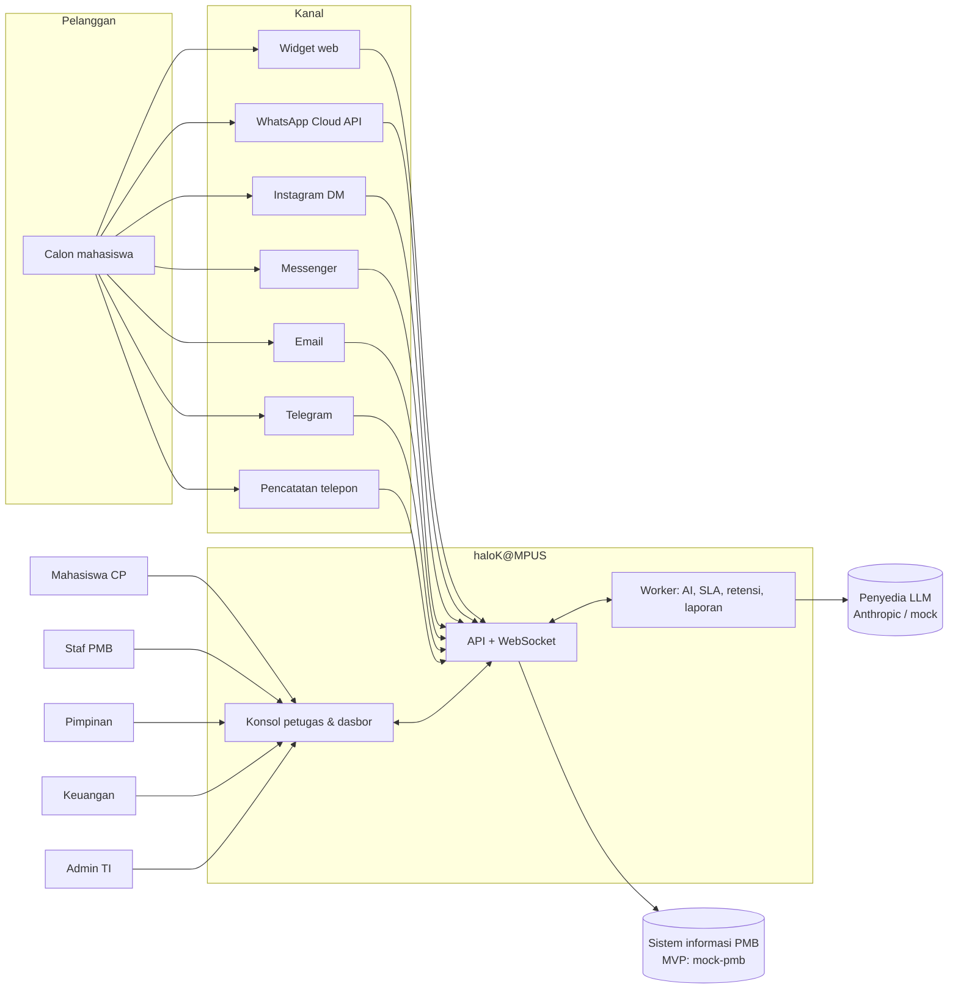
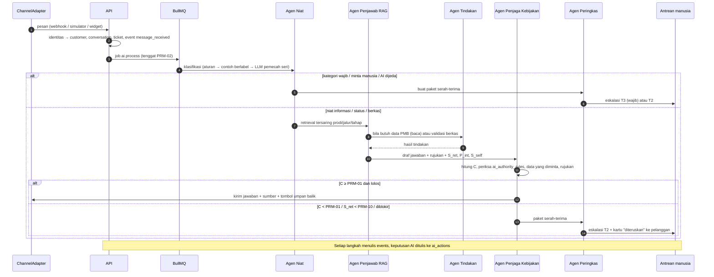
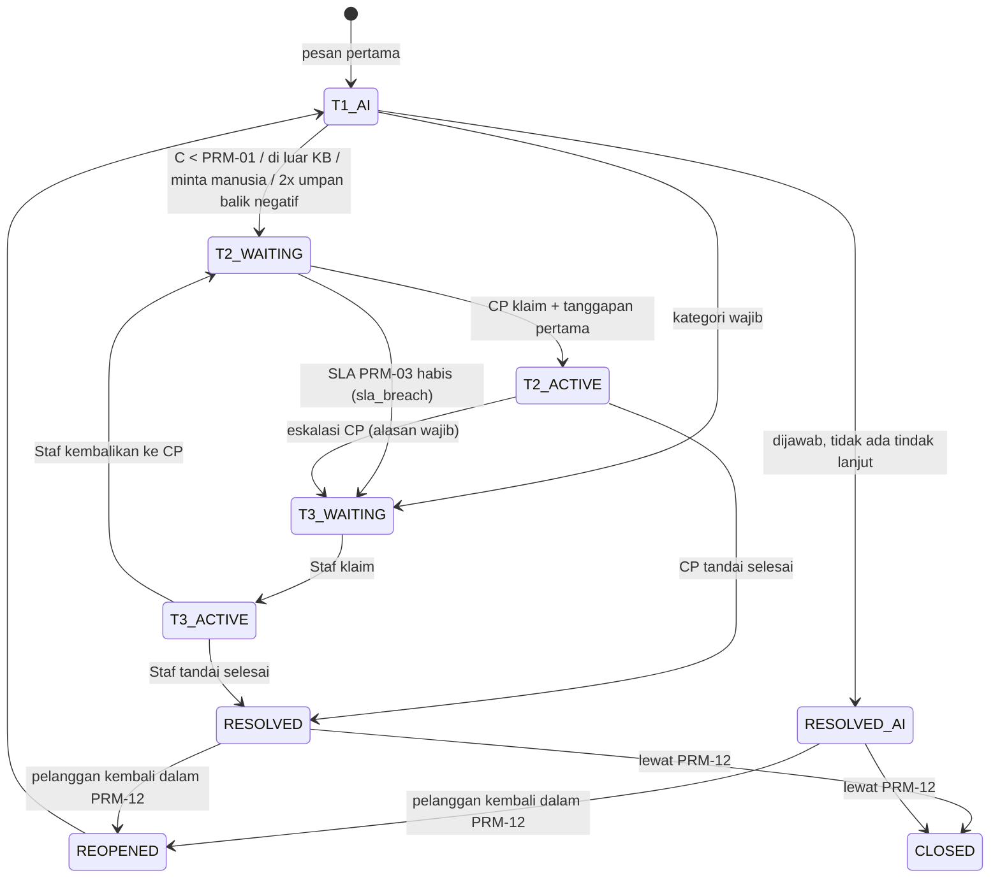

# Arsitektur — haloK@MPUS

Versi 0.1 (Fase 0). Dokumen ini menjabarkan cara SRS (`docs/SRS.md`) diwujudkan. Kode FR/NFR merujuk ke SRS.

## 1. Gambaran konteks



## 2. Kontainer dan struktur monorepo

```
/ (repositori)
├─ apps/
│  ├─ api/          Fastify: REST + Socket.IO, RBAC, webhook kanal, adaptor kanal (src/channels),
│  │                pipeline AI, SLA; entri kedua `worker` (BullMQ: AI, sapuan SLA, pengingat)
│  ├─ web/          Next.js (App Router) + Tailwind: konsol CP, Staf, Keuangan, Admin, parameter,
│  │                hak data pribadi, simulator kanal (/sim/*), halaman demo widget
│  ├─ widget/       Bundle tertanam (Vite + Preact, satu <script>, Shadow DOM)
│  └─ mock-pmb/     Fastify: mock API sistem PMB berdata DUMMY
├─ packages/
│  ├─ db/           Skema Prisma, migrasi SQL (pgvector, trigger append-only)
│  ├─ domain/       Logika murni: skor keyakinan, kalender hari kerja, SLA, perutean, kewenangan, status tiket, penyamaran
│  ├─ ai/           LLMProvider, EmbeddingProvider, agen, penyamar PII, pengklasifikasi niat, penjaga kebijakan, parser KB
│  └─ shared/       Kosakata bersama: peran & izin, kategori, alasan eskalasi, katalog peristiwa
│  └─ kpi/          Mesin KPI murni atas aliran peristiwa (rumus: docs/KPI.md, uji KT)
├─ config/          intents.yaml, ai-authority.yaml, files.yaml, reminders.yaml, templates/, pdp/, parameters.default.yaml, kb-dummy/
├─ e2e/             Playwright (alur E2E + tangkapan layar)
├─ docs/
└─ docker-compose.yml   postgres(pgvector), redis, mailpit; profil `app` (api, worker, web, mock-pmb), profil `local-llm` (ollama)
```

`api` dan `worker` berasal dari satu paket kode tetapi berjalan sebagai proses terpisah agar beban AI
pada masa puncak dapat diskalakan tanpa memengaruhi latensi konsol.

## 3. Alur pesan masuk (pipeline multi-agen)



Prinsip:
- **Penjaga kebijakan berada di luar LLM penjawab** dan bersifat deterministik (aturan + skor), sehingga injeksi prompt pada LLM tidak dapat melewatinya (NFR-06).
- LLM penjawab **tidak memiliki alat tulis** ke sistem PMB. Satu-satunya operasi tulis (penjadwalan ulang) dijalankan agen tindakan setelah diizinkan penjaga.
- Bila penyedia LLM gagal atau tenggat PRM-02 terlewati, job berakhir ke antrean manusia (FR-20).

## 4. Skor keyakinan komposit (FR-02, FR-03)

```
C = w_ret · S_ret + w_int · P_int + w_self · S_self        (w dari PRM-09, Σw = 1)
```

| Komponen | Sumber | Alasan |
|---|---|---|
| S_ret | Kemiripan kosinus tertinggi dari retrieval hibrida (pgvector + teks penuh), dinormalisasi 0–1 | Mengukur apakah jawaban benar-benar didukung basis pengetahuan |
| P_int | Probabilitas niat dari pengklasifikasi berbasis contoh berlabel (kNN/sentroid embedding, softmax) | Deterministik, dapat dijelaskan, tidak bergantung pada LLM |
| S_self | Penilaian diri LLM dalam keluaran terstruktur (0–1) | Hanya satu komponen dari tiga |

Gerbang keras (berlaku apa pun nilai C): S_ret < PRM-10 → di luar KB; niat ∈ kategori wajib → T3;
pemeriksaan penjaga gagal → eskalasi. Perbandingan dengan PRM-01 dilakukan dalam basis poin bilangan bulat
(`round(C·10000) < round(PRM01·10000)`) untuk menghindari galat titik mengambang (KB-01/KB-02).
Disimpan di `ai_actions.confidence` (decimal(5,4)) dan `ai_actions.confidence_components` (JSON: tiap
komponen, bobot, versi parameter, gerbang yang terpicu).

## 5. Status tiket dan SLA



Timer SLA:
- Setiap perpindahan ke status menunggu menulis baris `sla_timers` (tenggat absolut UTC, kebijakan, versi) **dan** menjadwalkan job BullMQ tertunda. Basis data adalah sumber kebenaran; job adalah pemicu.
- Penyapu (*reconciler*) berkala memeriksa timer kedaluwarsa yang belum diproses, sehingga timer tidak hilang bila Redis dimulai ulang (NFR-04).
- Tenggat "hari kerja" dihitung oleh `packages/domain/business-calendar` dari PRM-07; fungsi murni, diuji untuk akhir pekan, libur, dan batas jam kerja (KB-09).
- Tenggat inklusif: tanggapan pada `t ≤ deadline` memenuhi SLA (KB-03/KB-04).
- Perpindahan kanal tidak membuat tiket baru dan tidak mengubah timer (KB-05).

Keputusan Q4 (opsi b): SLA T2 hanya berjalan dalam jam layanan CP (PRM-19). Eskalasi di luar jam layanan
membuat timer dengan `starts_at` = pembukaan layanan berikutnya, sehingga tenggat = pembukaan + PRM-03.
Selama di luar jam layanan, AI tetap menjawab semua yang berada dalam kewenangannya; yang harus dialihkan
menunggu di antrean dengan janji waktu buka berikutnya (KB-14).

## 6. Diagram ER

Kolom ditampilkan ringkas; tipe lengkap ada di `packages/db/prisma/schema.prisma` (Fase 1).
Kolom bertanda `enc` dienkripsi AES-256-GCM di tingkat aplikasi; `bidx` = indeks buta HMAC untuk pencarian.
Setiap tabel data contoh memiliki `is_dummy`.

```mermaid
erDiagram
  customers ||--o{ customer_identities : memiliki
  customers ||--o{ consents : memberi
  customers ||--o{ conversations : melakukan
  customers ||--o{ tickets : memiliki
  customers ||--o{ data_subject_requests : mengajukan
  channels ||--o{ customer_identities : untuk
  channels ||--o{ conversations : lewat
  conversations ||--o{ messages : berisi
  tickets ||--o{ conversations : mencakup
  tickets ||--o{ ticket_assignments : ditangani
  tickets ||--o{ escalations : mengalami
  tickets ||--o{ sla_timers : diawasi
  tickets ||--o{ survey_responses : dinilai
  tickets ||--o{ qa_reviews : ditinjau
  messages ||--o{ ai_actions : memicu
  ai_actions ||--o{ overrides : dikoreksi
  ai_actions }o--o{ kb_chunks : merujuk
  kb_documents ||--o{ kb_chunks : dipecah
  users }o--|| roles : berperan
  users ||--o{ ticket_assignments : menangani
  users ||--o{ overrides : melakukan
  users ||--o{ qa_reviews : menilai
  users ||--o{ orchestration_cycles : menjalankan
  users ||--o{ presence_logs : mencatat
  surveys ||--o{ survey_responses : menghasilkan
  policy_parameters ||--o{ events : berlaku_saat
  sla_policies ||--o{ sla_timers : mengatur

  customers {
    uuid id PK
    string pmb_registration_no "enc + bidx"
    string display_name "enc"
    string program_code
    string admission_path
    string stage
    timestamp verified_at
    bool is_dummy
  }
  customer_identities {
    uuid id PK
    uuid customer_id FK
    uuid channel_id FK
    string external_id "enc + bidx"
    timestamp verified_at
    timestamp linked_with_consent_at
  }
  consents {
    uuid id PK
    uuid customer_id FK
    string purpose "service | proactive_reminder | service_improvement"
    string notice_version
    string status "granted | withdrawn"
    timestamp granted_at
    timestamp withdrawn_at
  }
  channels {
    uuid id PK
    string code "web | whatsapp | instagram | messenger | email | telegram | phone"
    json capabilities
    bool ai_paused
    json config "enc"
  }
  conversations {
    uuid id PK
    uuid customer_id FK
    uuid channel_id FK
    uuid ticket_id FK
    timestamp started_at
    timestamp last_activity_at
  }
  messages {
    uuid id PK
    uuid conversation_id FK
    string sender_type "customer | ai | cp | staff | system"
    uuid sender_user_id FK
    text body "enc"
    json attachments
    string delivery_status
    timestamp created_at
  }
  tickets {
    uuid id PK
    uuid customer_id FK
    string tier "T1 | T2 | T3"
    string status
    string category
    bool mandatory_category
    string intent
    timestamp opened_at
    timestamp resolved_at
    int reopen_count
    bool is_dummy
  }
  ticket_assignments {
    uuid id PK
    uuid ticket_id FK
    uuid user_id FK
    string tier
    timestamp claimed_at
    timestamp released_at
  }
  escalations {
    uuid id PK
    uuid ticket_id FK
    string from_tier
    string to_tier
    string reason_code
    text reason_note
    json handoff_package "enc"
    uuid actor_user_id FK
    timestamp created_at
  }
  sla_timers {
    uuid id PK
    uuid ticket_id FK
    uuid sla_policy_id FK
    string tier
    timestamp deadline_at
    string state "running | met | breached | cancelled"
  }
  sla_policies {
    uuid id PK
    string tier
    string category
    string param_code "PRM-02..05"
  }
  ai_actions {
    uuid id PK
    uuid message_id FK
    uuid ticket_id FK
    string agent "intent | answer | action | guard | summarizer"
    string action_type
    string authority_class "allowed | must_escalate | forbidden"
    decimal confidence
    json confidence_components
    json citations
    string outcome "sent | escalated | blocked | overridden"
    string provider
    string model
    int latency_ms
    uuid policy_version_id FK
  }
  overrides {
    uuid id PK
    uuid ai_action_id FK
    uuid staff_user_id FK
    string type "cancel | replace | correct"
    string cause_category
    text reason
    bool notify_customer
    timestamp created_at
  }
  audit_logs {
    bigint seq PK
    timestamp at
    string actor_type
    uuid actor_id
    string action
    string resource_type
    uuid resource_id
    json detail "tanpa isi pesan"
    string prev_hash
    string hash
  }
  events {
    bigint seq PK
    timestamp occurred_at
    string type
    uuid ticket_id
    uuid conversation_id
    uuid customer_pseudo_id
    string channel
    string tier
    string category
    string actor_type
    uuid actor_id
    json payload
    uuid policy_version_id
    bool is_dummy
  }
  kb_documents {
    uuid id PK
    string title
    int version
    string status "draft | tested | published | retired"
    date effective_from
    date effective_to
    json scope "prodi | jalur | tahap"
    uuid tested_by FK
    uuid published_by FK
  }
  kb_chunks {
    uuid id PK
    uuid document_id FK
    string section
    text content
    vector embedding "pgvector"
    tsvector tsv
  }
  policy_parameters {
    uuid id PK
    string code "PRM-xx"
    json value
    int version
    string status "proposed | approved | active | superseded"
    timestamp effective_from
    uuid proposed_by FK
    uuid approved_by FK
  }
  ai_authority_rules {
    uuid id PK
    string action_key
    string authority_class
    json conditions
    int version
    bool active
  }
  surveys {
    uuid id PK
    string code "csat | ces | nps | sus"
    string source_file
    json items
    bool active
  }
  survey_responses {
    uuid id PK
    uuid survey_id FK
    uuid ticket_id FK
    string channel
    json answers
    timestamp answered_at
  }
  qa_reviews {
    uuid id PK
    uuid ticket_id FK
    uuid reviewer_id FK
    string form_version
    json scores
    bool ai_answer_correct
  }
  orchestration_cycles {
    uuid id PK
    string cadence "weekly | daily"
    date period_start
    json checklist "plan | teach | monitor | intervene | learn"
    uuid owner_id FK
    timestamp closed_at
  }
  data_subject_requests {
    uuid id PK
    uuid customer_id FK
    string type "access | copy | correct | withdraw | delete"
    string status
    timestamp due_at
    timestamp closed_at
  }
  users {
    uuid id PK
    string email
    string password_hash "argon2id"
    string totp_secret "enc"
    uuid role_id FK
    bool active
  }
  roles {
    uuid id PK
    string code "cp | staff | leader | finance | admin"
  }
  presence_logs {
    uuid id PK
    uuid user_id FK
    string status "online | break | offline"
    timestamp at
  }
```



Tabel tambahan di luar daftar minimal: `sla_timers` (timer berbasis basis data), `presence_logs`
(sumber KPI occupancy), dan tabel tautan `ai_action_citations` (relasi `ai_actions`–`kb_chunks`).

Integritas: trigger PostgreSQL menolak `UPDATE`/`DELETE` pada `audit_logs` dan `events`; kolom `hash` =
SHA-256(`prev_hash` ‖ isi kanonis baris). Perintah `pnpm audit:verify` memeriksa rantai. Pengecualian satu-satunya:
job retensi (FR-66) tidak menghapus `events`; peristiwa memang tidak menyimpan isi pesan dan hanya memakai
pseudonim pelanggan, sehingga tetap dapat disimpan untuk penelitian.

## 7. Katalog peristiwa (`events.type`)

Sumber tunggal KPI (FR-59). Rumus lengkap ditulis di `docs/KPI.md` (Fase 3).

| Kelompok | Tipe peristiwa | Dipakai oleh KPI |
|---|---|---|
| Percakapan | `conversation_started`, `message_received`, `message_sent`, `customer_inactive_timeout` | FRT, volume, abandonment |
| AI | `ai_answer_sent`, `ai_action_executed`, `ai_guard_blocked`, `ai_fallback`, `ai_feedback` | containment, distribusi keyakinan, SL T1 |
| Tiket | `ticket_opened`, `ticket_claimed`, `first_human_response`, `ticket_resolved`, `ticket_reopened`, `ticket_closed`, `ticket_returned` | ASA, AHT, resolusi, FCR, reopen |
| Eskalasi | `escalation` (from, to, reason_code), `escalation_mandatory`, `handoff` | eskalasi per tingkat, handoff |
| SLA | `sla_started`, `sla_met`, `sla_breach` | Service Level |
| Tata kelola | `override_applied`, `ai_paused`, `ai_resumed`, `kb_published`, `parameter_changed`, `qa_review_submitted` | override rate, akurasi AI, skor QA |
| Petugas | `presence_changed`, `handling_started`, `handling_paused`, `handling_ended` | AHT, occupancy |
| Survei | `survey_sent`, `survey_answered` | CSAT, CES, NPS |
| PDP | `consent_granted`, `consent_withdrawn`, `identity_linked`, `dsr_opened`, `dsr_closed`, `pii_accessed`, `retention_run` | permintaan hak data |

Setiap peristiwa membawa `policy_version_id`, sehingga Service Level dihitung terhadap SLA yang berlaku
saat itu, bukan SLA saat laporan dibuat (NFR-16).

## 8. Omnichannel

| Kanal | Masuk | Keluar | Keamanan webhook | Tombol | Mode pengembangan |
|---|---|---|---|---|---|
| Web | `POST /public/messages` (token widget) | Socket.IO `/customer` | token bearer | ya | – |
| WhatsApp | `POST /webhooks/whatsapp` (Cloud API) | Graph API `/{phone-id}/messages` | `X-Hub-Signature-256` | maks. 3 | `WHATSAPP_MODE=simulator` |
| Instagram DM | `POST /webhooks/meta` (`object=instagram`) | Graph API `/me/messages` | `X-Hub-Signature-256` | quick reply (13) | `META_MODE=simulator` |
| Messenger | `POST /webhooks/meta` (`object=page`) | Graph API `/me/messages` | `X-Hub-Signature-256` | quick reply (13) | `META_MODE=simulator` |
| Telegram | `POST /webhooks/telegram` (Bot API) | `sendMessage` + inline keyboard | `X-Telegram-Bot-Api-Secret-Token` | inline (8) | `TELEGRAM_MODE=simulator` |
| Email | `POST /webhooks/email` (JSON inbound-parse/relay IMAP) | SMTP | `X-Webhook-Token` | tidak — opsi diketik | `EMAIL_MODE=simulator` |
| Telepon | Formulir petugas `POST /api/phone-calls` | diucapkan petugas, dicatat | sesi petugas + RBAC | – | – |

```ts
// apps/api/src/channels/types.ts — contract shared by every channel
interface ChannelAdapter {
  readonly code: ChannelCode;
  send(to: Recipient, msg: OutboundMessage): Promise<{ providerMessageId?: string; textOptions?: Record<string, string> } | void>;
}
```

- `OutboundMessage` bersifat semantik (teks, rujukan, tombol, kartu "diteruskan", alasan pengingat). `channels/render.ts` merender satu isi yang sama untuk semua kanal. Tombol yang melebihi kapasitas kanal menjadi baris "Balas dengan: 1 = …", dan pemetaannya disimpan di `conversations.state.options` sehingga balasan "1" atau "MANUSIA" diterjemahkan kembali menjadi aksi yang sama dengan tombol.
- Semua webhook memanggil satu pintu masuk `receiveInbound` (persetujuan → identitas → tiket → AI/antrean manusia). Kanal yang dinonaktifkan Admin diabaikan.
- Lampiran dari kanal pesan tidak diunduh; pelanggan menerima tautan `/unggah?t=` (token 2 jam) untuk pemeriksaan format/ukuran di peramban, dan hasilnya dikirim ke kanal asal.
- Tanda terima terkirim/dibaca (WhatsApp `statuses`, Meta `delivery`/`read`) memperbarui `messages.delivery_status` lewat `messages.provider_message_id`, hanya maju.
- Simulator (`/sim/:channel`) membangun payload berformat penyedia asli (termasuk tanda tangan) dan memanggil handler yang sama; balasan dibaca dari `sim_outbox`.
- Identitas terpadu: OTP ke email terdaftar + persetujuan penggabungan; tiket terbuka identitas kedua dilebur ke tiket pemilik. Kotak masuk terpadu (`/api/queue/all`) dan pilihan kanal balasan di konsol.
- Waktu nyata dari worker: `REALTIME_REDIS=true` memasang adapter Redis Socket.IO di API dan emitter Redis di worker.

## 9. AI dan penyedia

- `LLMProvider`: `complete(request): Promise<LlmResult>` dengan keluaran JSON tervalidasi zod. Implementasi:

  | Penyedia | Lokasi | Kegunaan |
  |---|---|---|
  | `ollama` | **lokal** (layanan `ollama` di Compose, profil `local-llm`) | LLM lokal; data tidak keluar server |
  | `openai_compatible` | lokal atau eksternal (menurut URL) | vLLM / LM Studio / llama.cpp server lokal, atau OpenAI / Gemini (endpoint kompatibel OpenAI) |
  | `anthropic` | eksternal | Claude API |
  | `mock` | lokal | Deterministik, untuk uji tanpa kunci API |

  Penugasan per agen dan urutan cadangan diatur PRM-20 (mis. `answer: [ollama, anthropic]`). Penyedia `external` selalu menerima teks yang sudah disamarkan; penyedia `local` juga menerima teks tersamar secara bawaan (dapat dimatikan per penyedia). Setiap panggilan mencatat penyedia, model, latensi, dan lokasi di `ai_actions`.
- `EmbeddingProvider`: `ollama` (mis. model embedding multibahasa yang dipasang lokal), `openai_compatible`, dan `mock` (hashing, untuk uji). Anthropic tidak menyediakan API embedding. Mengganti model embedding mewajibkan pengindeksan ulang KB (dimensi vektor disimpan per dokumen).
- Retrieval hibrida: pgvector (kosinus) + PostgreSQL full-text (konfigurasi `simple`, karena PostgreSQL tidak memiliki stemmer Bahasa Indonesia bawaan) dengan penggabungan peringkat; disaring metadata prodi/jalur/tahap dan tanggal berlaku.
- Penyamar PII (`packages/ai/redact`): mengganti nomor telepon, email, NIK, nomor pendaftaran, dan nama dengan token `⟦PHONE_1⟧` sebelum dikirim ke LLM; dipulihkan sesudahnya. Setiap payload ke LLM dapat direkam (mode audit pengembangan) untuk uji kebocoran PII (NFR-07).

## 10. Keamanan dan PDP

| Aspek | Desain |
|---|---|
| Transit | TLS di reverse proxy (Caddy/Nginx); HSTS |
| Simpan | AES-256-GCM per kolom sensitif, kunci dari env/KMS dengan rotasi berversi; indeks buta HMAC untuk pencarian nomor/ID |
| RBAC | Guard NestJS per endpoint + per event WebSocket, kebijakan dari satu tabel izin; uji matriks peran × endpoint otomatis |
| Penyamaran | Serializer server menurut peran (CP mendapat `S`); permintaan buka samaran oleh Staf tercatat `pii_accessed` |
| Webhook | Verifikasi tanda tangan penyedia (Meta `X-Hub-Signature-256`, Telegram secret token) |
| Sesi | Cookie httpOnly + SameSite, CSRF token, pembatasan laju login, 2FA TOTP |
| Admin | Endpoint admin tidak pernah mengembalikan isi pesan/PII (uji eksplisit) |
| Retensi | Job harian: setelah PRM-08, isi pesan dan PII dihapus/dianonimkan; `events` tetap (tanpa PII) |
| LLM | Lihat §9; alur lengkap di `docs/PDP.md` (Fase 1) |

## 11. Penyebaran

- Lokal/dev: `docker compose up` (postgres+pgvector, redis, api, worker, web, mock-pmb, mailpit untuk email uji).
- Server: **on-premise** (keputusan Q1). `docker compose --profile app` (image `docker/node.Dockerfile`, migrasi otomatis) + Caddy sebagai reverse proxy TLS (`docker/Caddyfile`); proses menolak start dengan pengaturan produksi tidak aman; `api` dan `worker` dapat direplikasi. Profil `local-llm` menambah layanan Ollama (sebaiknya di mesin ber-GPU; spesifikasi `[PERLU DATA]`, OP-09).
- Perkiraan beban (NFR-03): ±2,5 pesan/detik pada jam tersibuk masa puncak; satu instans `api` dan dua instans `worker` diperkirakan cukup untuk lapis aplikasi, sedangkan kapasitas LLM lokal diukur pada Fase 4.

## 12. Keputusan teknis (ringkasan ADR)

| No | Keputusan | Alasan |
|---|---|---|
| ADR-01 | **Fastify** + zod + Socket.IO (revisi; draf awal NestJS) | Spesifikasi mengizinkan NestJS atau Fastify. Fastify dipilih karena RBAC cukup ditegakkan dengan satu hook `preHandler` berbasis tabel izin yang mudah diuji, tanpa dekorator/metadata refleksi yang menyulitkan Vitest, dan lebih ringan untuk server lokal |
| ADR-02 | `api` dan `worker` dipisah | Beban AI masa puncak tidak memperlambat konsol |
| ADR-03 | Widget Preact + Shadow DOM, bukan Next.js | Bundle kecil (target < 60 KB gzip), tidak bentrok CSS situs PMB |
| ADR-04 | Timer SLA: basis data sebagai kebenaran + BullMQ sebagai pemicu + penyapu | Tahan restart Redis; tenggat dapat diaudit |
| ADR-05 | Penjaga kebijakan deterministik di luar LLM | Kewenangan tidak bergantung pada kepatuhan LLM; tahan injeksi prompt |
| ADR-06 | P_int dari pengklasifikasi contoh berlabel | Skor dapat dijelaskan dan direproduksi, tidak bergantung pada penilaian diri LLM |
| ADR-07 | KPI sebagai fungsi murni atas aliran peristiwa + snapshot harian | Mudah diuji dengan data hitung tangan; angka dapat direproduksi |
| ADR-08 | Embedding lokal (Ollama) sebagai bawaan produksi | Minimisasi data keluar; server lokal (Q1) |
| ADR-12 | Satu perender semantik + opsi bernomor untuk kanal tanpa tombol | Paritas fitur (FR-56) tanpa logika per kanal di pipeline |
| ADR-13 | Lampiran kanal pesan tidak diunduh; tautan unggah aman | Minimisasi data; berkas resmi tetap diunggah ke portal PMB |
| ADR-14 | Email masuk lewat webhook JSON generik | Bebas penyedia; relay IMAP atau inbound-parse dapat dipakai |
| ADR-15 | Telepon sebagai kanal yang dioperasikan manusia | Peristiwa & KPI sama dengan kanal lain; persetujuan lisan dicatat |
| ADR-16 | KPI dihitung saat diminta dari `events` (tanpa tabel snapshot) | Satu sumber kebenaran; angka dapat direproduksi; kinerja diukur Fase 4 |
| ADR-17 | Ekspor penelitian: pseudonim HMAC + daftar putih kunci payload + persetujuan "perbaikan layanan" | Tidak ada isi pesan/kontak; pseudonim stabil antarekspor; selaras PDP |
| ADR-18 | Laporan PDF (pdfkit) & XLSX (exceljs) disimpan di basis data | Tanpa peramban di server; laporan mingguan otomatis oleh worker |
| ADR-11 | Beberapa penyedia LLM dengan urutan cadangan per agen | Q1: server lokal dengan opsi LLM lokal dan eksternal; kegagalan satu penyedia tidak menghentikan layanan |
| ADR-09 | Rantai hash pada audit dan peristiwa | Bukti ketidakberubahan untuk keperluan penelitian dan PDP |
| ADR-10 | Jam dapat disuntikkan (`Clock`) di seluruh domain | Uji SLA, kalender, dan retensi yang deterministik |
