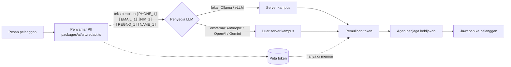

# Pelindungan Data Pribadi — haloK@MPUS

Acuan: Undang-Undang No. 27 Tahun 2022 tentang Pelindungan Data Pribadi (UU PDP).
Dokumen ini menjelaskan **bagaimana sistem memperlakukan data pribadi** (FR-63…FR-69, NFR-05, NFR-07).
Kesesuaian hukum akhir (dasar pemrosesan, jangka waktu, transfer lintas negara) tetap harus ditetapkan
oleh bagian hukum/DPO institusi (butir terbuka OP-08, PRM-08, PRM-13).

## 1. Data yang diproses

Daftar resmi ada di `config/pdp/allowed-data.yaml`. Di luar daftar ini, AI dan formulir tidak boleh meminta data
(ditegakkan oleh agen penjaga kebijakan, pola `forbidden_data_request_patterns` di `config/ai-authority.yaml`).

| Data | Asal | Disimpan di | Perlindungan |
|---|---|---|---|
| Nama panggilan | Profil kanal / sistem PMB (kata pertama) | `customers.display_name_enc` | AES-256-GCM |
| Nomor pendaftaran | Diketik pelanggan saat verifikasi | `customers.reg_no_enc` + `reg_no_bidx` | AES-256-GCM + indeks buta HMAC |
| Email terdaftar | Sistem PMB (setelah OTP) | `customers.contact_email_enc` | AES-256-GCM |
| Nomor WhatsApp / ID kanal | Kanal | `customer_identities.external_id_enc` + `_bidx` | AES-256-GCM + HMAC |
| Prodi, jalur, tahap | Sistem PMB | `customers.program_code` dst. | Bukan data sensitif; dipakai untuk Filtering |
| Isi pesan | Pelanggan & petugas | `messages.body_enc` | AES-256-GCM |
| Ringkasan serah-terima | Agen peringkas | `escalations.handoff_enc`, `tickets.summary_enc` | AES-256-GCM |
| Berkas unggahan | Widget | **tidak disimpan** — hanya divalidasi di memori (format, ukuran, jenis) | — |
| Kode OTP | Sistem | `otps.code_hash` | Hanya hash SHA-256, berlaku PRM-17 |

`events` (sumber KPI) dan `audit_logs` **tidak memuat isi pesan atau data pribadi**; pelanggan diwakili `customer_pseudo_id` (UUID acak).

## 2. Persetujuan (FR-63)

Tiga tujuan, dicatat per baris di `consents` beserta versi pemberitahuan (`notice_version`), kanal, dan waktu:

| Tujuan | Sifat | Akibat bila tidak/ditarik |
|---|---|---|
| `service` — layanan helpdesk | Wajib | Pesan tidak diproses. Di widget API menolak (403 `consent_required`); di WhatsApp pesan pertama **ditahan** lalu diproses otomatis begitu pelanggan menjawab SETUJU (prinsip Frugality). |
| `proactive_reminder` — pengingat proaktif | Opsional | Tidak ada pengingat (diuji KB-13). |
| `service_improvement` — perbaikan layanan | Opsional | Data pelanggan tidak ikut ekspor penelitian (Fase 3). |

Setiap pemberian/penarikan menghasilkan peristiwa `consent_granted` / `consent_withdrawn`.

## 3. Hak subjek data (FR-65, FR-69)

- Tautan pribadi berlaku 24 jam (`customer_sessions.purpose = data_rights`), dapat diminta dari kanal mana pun (ketik "data pribadi saya" atau tombol "Data pribadi" di widget).
- Halaman `/data-pribadi`: melihat data, mengunduh salinan (JSON), menarik/memberi persetujuan, dan mengajukan permintaan (lihat, salinan, koreksi, tarik, hapus).
- Permintaan dicatat di `data_subject_requests` + peristiwa `dsr_opened`. Batas penyelesaian dihitung dari **PRM-13 — `[PERLU DATA]`**; selama kosong, `due_at` kosong.
- Koreksi data pendaftaran diteruskan ke sistem PMB; haloK@MPUS tidak mengubah data pendaftar (tindakan `pmb.update_applicant` berkelas *dilarang*).
- Alur pemrosesan permintaan oleh petugas: Fase 3.

## 4. Akses petugas (FR-26, FR-67)

- Server menyamarkan nama, telepon, email, dan nomor pendaftaran untuk **semua peran** di detail tiket (mis. `0812*****890`).
- Hanya `staff` yang dapat membuka samaran, wajib dengan alasan; setiap pembukaan tercatat `pii_accessed` di audit dan peristiwa.
- `admin` tidak memiliki izin membaca percakapan atau data pelanggan; `finance` hanya tiket pembayaran; `leader` hanya agregat.
- Penolakan izin tercatat sebagai `authz_denied` (KB-06).

## 5. Aliran data ke penyedia LLM (FR-68)

- Penyamaran berlaku untuk **semua** penyedia (lokal maupun eksternal). Peta token hanya ada di memori proses selama satu panggilan.
- Yang dikirim: pertanyaan tersamar, potongan dokumen basis pengetahuan resmi, dan profil non-sensitif (prodi/jalur/tahap). Riwayat dikirim hanya ke agen peringkas (≤ 20 pesan terakhir, tersamar).
- Penyedia dan urutan cadangan per agen ditentukan **PRM-20**. Untuk server lokal (keputusan Q1), konfigurasi yang disarankan agar data tidak keluar server: `{"default": ["ollama"]}`. Bila penyedia eksternal dipakai, berlaku ketentuan transfer data lintas negara (OP-08).
- Setiap tindakan AI mencatat penyedia, model, dan lokasi (`local`/`external`) di `ai_actions`, sehingga dapat diaudit data mana yang keluar server.
- Embedding: bawaan pengembangan `mock` (lokal); produksi disarankan `ollama` (lokal).
- Uji: `SU-68` (API) dan uji unit penyamar memastikan nomor telepon/email tidak muncul di prompt.

## 6. Keamanan teknis

TLS di reverse proxy; AES-256-GCM per kolom (`DATA_ENCRYPTION_KEY`); HMAC indeks buta (`BLIND_INDEX_KEY`); kata sandi argon2id; 2FA TOTP opsional; sesi cookie httpOnly + SameSite=Strict + token CSRF; penguncian akun setelah 5 kegagalan; pembatasan laju; verifikasi tanda tangan webhook Meta (`X-Hub-Signature-256`); log aplikasi tanpa isi pesan (header `authorization`/`cookie` diredaksi).

## 7. Retensi (FR-66)

Penghapusan/anonimisasi otomatis mengikuti **PRM-08 — `[PERLU DATA]`**. Job retensi dibangun pada Fase 3; selama PRM-08 kosong, job tidak menghapus apa pun. `events` tetap disimpan karena tidak memuat data pribadi.

## 8. Data pengembangan

Seluruh data contoh bertanda `DUMMY` (kolom `is_dummy`, teks "[DUMMY]", domain `contoh.invalid`). Simulator kanal (`ENABLE_SIMULATORS=true`) menyimpan pesan keluar kelima kanal di `sim_outbox` **tanpa enkripsi** dan wajib dimatikan di produksi.

## 9. Ketentuan per kanal (Fase 2)

- **Lampiran** dari WhatsApp/Instagram/Messenger/Telegram/Email tidak diunduh; pelanggan menerima tautan unggah aman dan berkas hanya diperiksa di memori.
- **Email**: alamat pengirim menjadi identitas kanal dan kontak (terenkripsi); kutipan balasan lama dibuang sebelum diproses.
- **Telepon**: petugas wajib membacakan pemberitahuan dan mencentang persetujuan lisan; tercatat sebagai persetujuan `service` dengan kanal `phone`. Petugas dilarang mencatat data di luar daftar yang diizinkan.
- **Survei CSAT/CES**: jawaban disimpan sebagai angka per butir, tanpa teks bebas; butir resmi dari tim instrumen.

## 10. Ekspor penelitian & hak data (Fase 3)

- Ekspor penelitian (`/api/exports/research`, Pimpinan/Staf): hanya pelanggan yang memberi persetujuan **perbaikan layanan**; pseudonim HMAC-SHA256 dengan `RESEARCH_PSEUDONYM_KEY`; hanya kunci payload pada daftar putih (angka/enumerasi, tanpa teks bebas); data DUMMY dikecualikan kecuali diminta; setiap ekspor tercatat di audit.
- Permintaan **hapus** dijalankan Staf PMB dengan menganonimkan pelanggan: isi pesan diganti "[dihapus]", kontak/nama/nomor pendaftaran dikosongkan, identitas kanal diputus, sesi & OTP dihapus. Peristiwa KPI (tanpa data pribadi) tetap.
- Job retensi harian menjalankan anonimisasi yang sama untuk pelanggan tidak aktif lebih dari PRM-08 hari; selama PRM-08 kosong, job hanya mencatat `retention_run` (dilewati).
